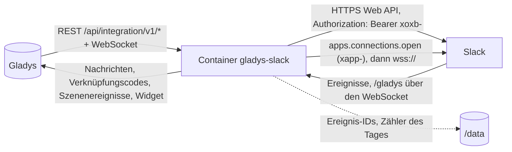
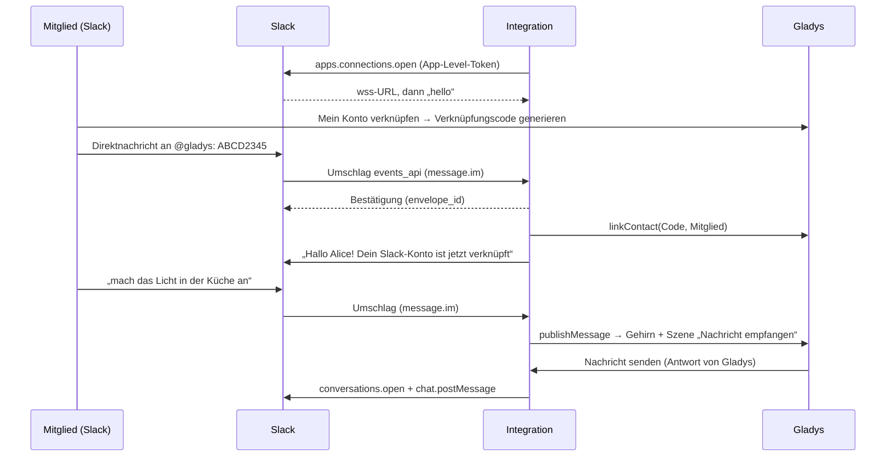
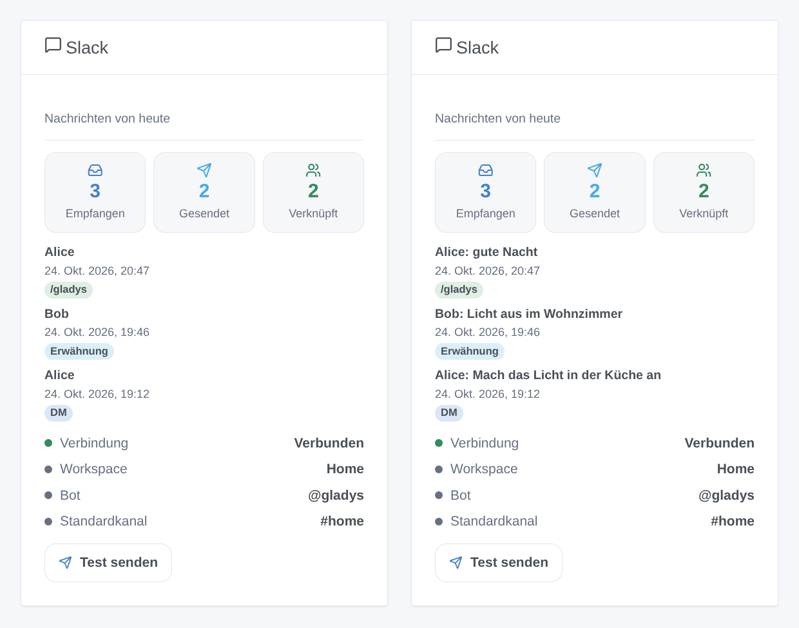

# Gladys Slack

[English](README.md) · [Français](README.fr.md) · **Deutsch** · [Español](README.es.md)

[](LICENSE)
[](https://github.com/William-De71/gladys-slack/releases)
[](https://github.com/William-De71/gladys-slack/actions/workflows/release.yml)
[](https://gladysassistant.com)


Externe Integration von [Gladys Assistant](https://gladysassistant.com) für **Slack**: Schreib mit Gladys per Direktnachricht an einen Bot deines eigenen Workspace, erhalte dort ihre Benachrichtigungen und Kamerabilder und lass deine Szenen auf Nachrichten, Erwähnungen und `/gladys` reagieren. Sie nutzt den **Socket Mode**: Die Integration öffnet die Verbindung zu Slack selbst, Gladys braucht also weder eine öffentliche URL noch Gladys Plus.

Benutzerdokumentation: [English](docs/en.md) · [Français](docs/fr.md) · [Deutsch](docs/de.md) · [Español](docs/es.md).

**Inoffizielle Integration, ohne Verbindung zu Slack Technologies.** **Noch nicht in einem echten Slack-Workspace getestet**: Sie wird gegen ein falsches Slack (Web API und Socket Mode) getestet, das nach der Dokumentation von Slack (docs.slack.dev) gebaut ist.

## Funktionen

- **Deine eigene Slack-App**, mit einem Klick aus [`slack-app-manifest.json`](slack-app-manifest.json) erstellt (ein vorausgefüllter Link in der Konfiguration): Socket Mode, ein Bot `@gladys`, der Befehl `/gladys`, die kleinste Menge an Scopes, die der Code nutzt.
- **Mit Gladys schreiben**: Jeder Benutzer verknüpft sein Slack-Konto mit dem Verknüpfungscode von Gladys (per Direktnachricht an den Bot oder mit `/gladys <Code>`); seine Direktnachrichten gehen dann an Gladys, die in derselben Unterhaltung antwortet, wie bei der nativen Telegram-Integration.
- **Benachrichtigungen und Kamerabilder** von Gladys an verknüpfte Mitglieder, in der Direktnachricht des Bots.
- **Standardmäßig sicher**: Nicht verknüpfte Mitglieder erhalten nur eine Einladung zum Verknüpfen (einmal am Tag), nie das Gehirn oder die Szenen; Bots, der Bot selbst, Bearbeitungen, erneut zugestellte Ereignisse und Nachrichten, die älter als 5 Minuten sind, werden ignoriert.
- **4 Szenenauslöser** (Nachricht empfangen, @gladys erwähnt, `/gladys` eingegeben, Nachricht nicht gesendet), **1 Szenenaktion** (eine Slack-Nachricht in einen Kanal, an ein Mitglied oder in einen Thread senden) und **1 Dashboard-Widget** (Verbindung, Nachrichten des Tages, letzte Nachrichten, Test-Schaltfläche).
- **Innerhalb der Grenzen von Slack**: eine Nachricht pro Sekunde und Kanal, `Retry-After` bei HTTP 429 beachtet, jeder Socket-Mode-Umschlag binnen 3 Sekunden bestätigt, Neuverbindung, wenn Slack die Verbindung erneuert.
- Vier Sprachen überall: Englisch, Französisch, Deutsch, Spanisch.

## So funktioniert es




Vom Verknüpfungscode zur Unterhaltung:



### Transport

`transports: ["cloud"]`: Alles läuft über Slack. Die Web API wird unter `https://slack.com/api/` mit dem Bot-Token (`xoxb-`) im Header `Authorization` aufgerufen; der Socket Mode ist ein WebSocket, den der Container zu Slack öffnet, mit einer Einmal-URL, die mit dem App-Level-Token (`xapp-`) angefordert wird. Die mit Gladys ausgetauschten Nachrichten und die Namen der Mitglieder laufen also über die Server von Slack. Die Tokens sind `secret`-Felder von Gladys, werden nie protokolliert und nie nach `/data` geschrieben; `/data` enthält nur die IDs bereits behandelter Ereignisse, die bereits eingeladenen Mitglieder und die Zähler des Tages.

## Slack-App erstellen

1. Öffne in der Konfiguration der Integration **Gladys-App in Slack erstellen**: Die App-Erstellungsseite von Slack öffnet sich mit dem Manifest unten bereits ausgefüllt. Wähle deinen Workspace, prüfe, **Create**.
2. **Basic Information → App-Level Tokens → Generate Token and Scopes**: Füge den Scope `connections:write` hinzu und kopiere das `xapp-`-Token.
3. **Install App → Install to Workspace**, erlauben, dann das **Bot User OAuth Token** (`xoxb-`) kopieren.
4. Füge beide Tokens in der Konfiguration der Integration ein und speichere.

Ohne den vorausgefüllten Link: [api.slack.com/apps](https://api.slack.com/apps) → **Create New App → From a manifest**, Workspace wählen, Manifest einfügen.

### Das Manifest der Slack-App

Dasselbe wie [`slack-app-manifest.json`](slack-app-manifest.json). Jeder Scope dient einem Aufruf oder einem Ereignis des Codes: `chat:write` (senden), `im:write` (Direktnachricht öffnen), `im:history` / `channels:history` / `groups:history` (Nachrichten aus Direktnachrichten sowie aus öffentlichen und privaten Kanälen empfangen, in denen der Bot ist), `app_mentions:read` (@gladys), `commands` (`/gladys`), `files:write` (Kamerabilder), `users:read` (Namen), `channels:read` / `groups:read` (Kanalnamen, Prüfung des Standardkanals). Kein Benutzer-Token, kein `users:read.email`.

```json
{
  "_metadata": { "major_version": 1 },
  "display_information": {
    "name": "Gladys",
    "description": "Gladys Assistant, the home automation assistant of the house.",
    "background_color": "#2f6fb5"
  },
  "features": {
    "app_home": {
      "home_tab_enabled": false,
      "messages_tab_enabled": true,
      "messages_tab_read_only_enabled": false
    },
    "bot_user": { "display_name": "gladys", "always_online": true },
    "slash_commands": [
      {
        "command": "/gladys",
        "description": "Talk to Gladys, or send a link code",
        "usage_hint": "turn on the kitchen light",
        "should_escape": false
      }
    ]
  },
  "oauth_config": {
    "scopes": {
      "bot": [
        "app_mentions:read",
        "channels:history",
        "channels:read",
        "chat:write",
        "commands",
        "files:write",
        "groups:history",
        "groups:read",
        "im:history",
        "im:write",
        "users:read"
      ]
    }
  },
  "settings": {
    "event_subscriptions": {
      "bot_events": ["app_mention", "message.channels", "message.groups", "message.im"]
    },
    "org_deploy_enabled": false,
    "socket_mode_enabled": true,
    "token_rotation_enabled": false
  }
}
```

Die App ist eine interne App deines Workspace (nie verteilt): Die Ratenlimits von 2025 für kommerzielle Apps außerhalb des Marketplace (`conversations.history` mit 1 Anfrage pro Minute) gelten für sie nicht, und die Integration liest den Verlauf ohnehin nicht (Nachrichten kommen als Ereignisse).

## Szenenauslöser, -aktionen und Widget



Die Bilder sind **generierte Illustrationen**, mit dem echten Widget-Code aus erfundenen Mitgliedern und Nachrichten gezeichnet, keine Screenshots.

**Widget „Slack“**: heute empfangene und gesendete Nachrichten, verknüpfte Mitglieder, die letzten 8 Nachrichten verknüpfter Mitglieder (Direktnachricht, Erwähnung, `/gladys`, Kanal; ihr Text nur mit der Widget-Einstellung **Text der Nachrichten anzeigen**, standardmäßig aus, da ein Dashboard geteilt sein kann; nur im Speicher gehalten), die Verbindung, der Workspace, der Bot, der Standardkanal und eine Schaltfläche **Test senden** (an den Standardkanal oder an jedes verknüpfte Mitglied).

**Szenenauslöser**, nur für Mitglieder, die mit einem Gladys-Benutzer verknüpft sind, nie wegen einer Szenenaktion:

| Auslöser                       | Filter                                                                                   | Variablen                                                                               |
| ------------------------------ | ---------------------------------------------------------------------------------------- | --------------------------------------------------------------------------------------- |
| Slack-Nachricht empfangen      | wo (Direktnachricht, öffentlich, privat), Kanal, Mitglied, Gladys-Benutzer, genauer Text | Text, Mitglieds-ID und -Name, Gladys-Benutzer und Vorname, Kanal, Art, ts, Thread, Link |
| Gladys auf Slack erwähnt       | Kanal, Mitglied, Gladys-Benutzer, genauer Text (nach der Erwähnung)                      | dieselben, ohne die Art                                                                 |
| /gladys-Befehl eingegeben      | Kanal, Mitglied, Gladys-Benutzer, genauer Text                                           | Text, Befehl, Mitglied, Gladys-Benutzer, Kanal-ID und -Name                             |
| Slack-Nachricht nicht gesendet | Ursache, Gladys-Benutzer                                                                 | Mitglieds-ID, Gladys-Benutzer, Ursache, Slack-Fehlercode                                |

**Szenenaktion** „Slack-Nachricht senden“: eine Kanal-ID (`C…`, der Bot muss darin sein) oder eine Mitglieds-ID (`U…`, Direktnachricht), leer für den Standardkanal; der Text mit Slack-Formatierung (`*fett*`, `<@U…>`, `<https://…|Text>`); ein optionaler Thread (`{{triggerEvent.data.ts}}` antwortet auf die Nachricht, die die Szene gestartet hat). Ausgaben: `ts`, `channel_id`, `link`. Ein Kamerabild geht über die Gladys-Aktion **Kamerabild senden** an einen auf Slack verknüpften Benutzer.

Beispiele:

- **@gladys erwähnt** in `#zuhause` mit dem Text „Licht aus“ → alle Lichter ausschalten, dann **Slack-Nachricht senden** „Erledigt ✅“ im Thread `{{triggerEvent.data.ts}}`.
- **/gladys eingegeben** mit „gute Nacht“ → die Nachtszene, Alarm an.
- **Haustür geöffnet**, während niemand zu Hause ist → **Slack-Nachricht senden** an `#zuhause` und ein Kamerabild an die verknüpften Benutzer.

## Voraussetzungen

- Gladys Assistant **5.1.0** oder neuer (Dashboard-Widgets und Szenenauslöser / -aktionen): Ältere Instanzen können die Integration nicht installieren.
- Ein Slack-Workspace, in dem du eine App installieren darfst (jeder Tarif; in manchen Workspaces muss ein Admin sie genehmigen).
- Internetzugang von Gladys aus (nur ausgehend: kein Port zu öffnen).

## Installation

- **Aus dem Store**: Integrationen → Slack → Installieren.
- **Über die URL des Repositorys**: Integrationen → Über eine URL installieren → `https://github.com/William-De71/gladys-slack`.
- **Entwicklermodus**: Starte den Container selbst mit den Variablen, die Gladys anzeigt (siehe Entwicklung).

## Konfiguration

| Feld                               | Standard    | Bedeutung                                                                                                        |
| ---------------------------------- | ----------- | ---------------------------------------------------------------------------------------------------------------- |
| Bot-Token                          | —           | Pflicht, geheim: `xoxb-…` (OAuth & Permissions)                                                                  |
| App-Level-Token                    | —           | Pflicht, geheim: `xapp-…` mit `connections:write` (Basic Information)                                            |
| Direktnachrichten an Gladys senden | an          | aus: Nachrichten und `/gladys` verknüpfter Mitglieder erreichen nur die Szenen                                   |
| Standardkanal                      | —           | Kanal-ID (`C…`, `G…`) oder Mitglieds-ID (`U…`) für die Szenenaktion und die Test-Schaltfläche                    |
| Sprache des Bots                   | automatisch | die wenigen Texte, die der Bot an Mitglieder schreibt, die Gladys noch nicht kennt (Einladung, abgelehnter Code) |

**Verbindung testen** (Schaltfläche der Konfiguration) prüft das Bot-Token und zeigt den Workspace, den Zustand des Socket Mode, den Standardkanal (und ob der Bot darin ist) und die Anzahl verknüpfter Mitglieder.

## Verwendung

1. Erstelle die Slack-App (siehe oben) und füge beide Tokens ein.
2. Jeder Benutzer: **Mein Konto verknüpfen → Verknüpfungscode generieren** in der Konfiguration der Integration, dann den Code in Slack an `@gladys` senden (Apps → Gladys → Nachrichten) oder `/gladys <Code>` eingeben.
3. Schreib `@gladys`: Gladys antwortet. Lade den Bot (`/invite @gladys`) in die Kanäle ein, in denen Nachrichten und Erwähnungen Szenen auslösen sollen.
4. Füge das Widget einem Dashboard hinzu; baue Szenen mit den Auslösern und der Aktion.

## Entwicklung

```bash
npm install
npm test                       # node --test, ein falsches Slack auf 127.0.0.1, nie das Netzwerk
npm run lint                   # ESLint
npm run format:check           # Prettier
npm run coverage               # node --test mit der Abdeckung von src/
npx github:GladysAssistant/integration-store . --skip-image-check
node scripts/fake-slack.mjs 18790   # das falsche Slack (Web API + Socket Mode) auf 127.0.0.1
scripts/check-simulator.sh     # die echte Integration gegen das falsche Slack in einem anderen Prozess
scripts/build-cover.sh         # cover.jpg aus docs/assets/cover.svg
docs/illustrations/render.sh   # docs/assets/widgets.<lang>.png
```

Lokal liest das SDK `GLADYS_HOST_API_URL`, `GLADYS_INTEGRATION_TOKEN` und `GLADYS_INTEGRATION_SELECTOR` (von Gladys im Entwicklermodus angezeigt). `SLACK_API_URL=http://127.0.0.1:18790/api/` richtet die Integration auf das falsche Slack aus (nur `slack.com` oder eine lokale Adresse werden akzeptiert: Ein Token geht nie woanders hin). `DEBUG=gladys-integration-sdk` zeigt die Protokolle des SDK; `LOG_LEVEL=debug` zeigt, warum ein Ereignis ignoriert wurde (nie den Text einer Nachricht auf einer niedrigeren Stufe).

Die Tests decken die Textumwandlungen ab (Entitäten und Erwähnungen von Slack, Maskierung, lange Nachrichten, Bilder), die Einordnung der Umschläge (Bots, Bearbeitungen, Untertypen, Erwähnungen in einer Direktnachricht), die Konfiguration, `/data`, den Web-API-Client (Bearer-Header, Fehler `{ok:false}`, 429 und `Retry-After`, eine Nachricht pro Sekunde und Kanal, erlaubte Hosts), den Socket Mode (fehlendes hello, unbeantworteter Ping, Bestätigungen mit Inhalt) und die ganze Integration gegen das falsche Gladys des SDK und das falsche Slack: Verknüpfung, Unterhaltung, Fremde, Duplikate, Erneuerung, Abbruch, ausgeschalteter Socket Mode, 429, Bilder, Fehlschläge, die Szenenaktion, das Widget, die Konfigurationsschaltfläche. `test/structure.test.js` friert jeden Schlüssel ein, den Benutzer speichern. `npm run coverage` meldet rund 93 % abgedeckte Zeilen von `src/` (0.1.0).

## Release-Prozess


Jeder Merge auf `main` startet die CI und berechnet dann die Version aus den [Conventional Commits](https://www.conventionalcommits.org/) seit dem letzten Tag: `feat` → Minor, `fix` / `perf` → Patch, `!` oder `BREAKING CHANGE` → Major (unter 1.0.0 ein Minor); `docs`, `chore`, `ci`, `test`, `style`, `refactor`, `build` allein veröffentlichen nichts. Der Changelog-Abschnitt wird erzeugt, das Tag gepusht, das Multi-Architektur-Image gebaut, dann erhält `main` den Release-Commit, das GitHub Release wird erstellt und ein letzter Job prüft das öffentliche Image, den Validator des Stores und das Topic.

- Der Titel des Pull Requests wird zum Squash-Commit und dann zur Changelog-Zeile: Schreib ihn auf Englisch, für den Benutzer (`pr-title.yml` prüft ihn). Bearbeite `CHANGELOG.md` nie von Hand.
- 1.0.0 ist eine Entscheidung: Actions → Release → Run workflow mit `release-as: 1.0.0`. `dry-run` zeigt Version und Notizen, ohne etwas zu veröffentlichen.
- **Geschützter Branch**: Das Release pusht seinen Commit mit `GITHUB_TOKEN` auf `main`. Das Ruleset `protect-main` (kein Löschen, kein Force-Push) lässt ihn durch; eine strengere Regel (Pull Request Pflicht, Status-Checks) bräuchte GitHub Actions in ihrer Bypass-Liste oder eine GitHub App.
- Mach nach dem ersten Release das Paket auf `ghcr.io` öffentlich (Package settings → Change visibility), sonst kann Gladys es nicht herunterladen.

## Fehlerbehebung

Siehe [docs/de.md](docs/de.md#fehlerbehebung). Melde Probleme mit den Versionen von Gladys und der Integration, der Meldung von **Verbindung testen** und den Protokollen mit `DEBUG=gladys-integration-sdk`. Füge nie ein Token oder private Nachrichten ein.

## Mitwirken

Issues und Pull Requests sind willkommen. Führe vor einem Pull Request `npm run format:check && npm run lint && npm test` aus und lass jeden gespeicherten Schlüssel unverändert (siehe [CLAUDE.md](CLAUDE.md)). Ein Test in einem echten Workspace (Protokolle ohne Tokens) hilft mehr als alles andere.

## Sicherheit

Siehe [SECURITY.md](SECURITY.md): Melde Schwachstellen vertraulich. Die Tokens sind `secret`-Felder, werden nur in einem Header an `slack.com` gesendet, nie protokolliert und nie nach `/data` geschrieben. Der Text der Nachrichten wird nie protokolliert (nur ihre IDs, auf Debug-Stufe). Nur verknüpfte Mitglieder erreichen das Gehirn von Gladys und damit die Befugnisse ihres Gladys-Benutzers: Verknüpfe nur Personen, denen du vertraust.

## Kommende Screenshots

Die Bilder oben sind Illustrationen, keine Screenshots. Echte Screenshots kommen nach `docs/assets/screenshots/` (PNG, 1280 × 800): `configuration.png` (die Tokens und die Hilfeabschnitte), `link.png` (der Verknüpfungscode, an den Bot in Slack gesendet), `conversation.png` (eine Unterhaltung mit Gladys in Slack), `slash-command.png` (`/gladys` und seine private Antwort), `scene-mention.png` (der Auslöser „Gladys auf Slack erwähnt“ in einer Szene).

## Bekannte Grenzen

- Nie in einem echten Workspace getestet: Die Inhalte, die Bestätigungsfrist und das Ping-Verhalten des Socket Mode folgen der Dokumentation und dem offiziellen SDK von Slack, nicht einer echten Sitzung.
- Gruppen-Direktnachrichten (mehrere Personen mit dem Bot) werden nicht behandelt; Reaktionen, Schaltflächen und von Mitgliedern gesendete Dateien werden nicht gelesen (eine Datei löst nur den Auslöser aus, mit ihrem Text).
- Die Antwort von Gladys geht immer in die Direktnachricht, auch bei `/gladys` in einem Kanal.
- Ein Verknüpfungscode läuft nach 15 Minuten ab (Gladys); der Tab Nachrichten muss in der App aktiviert sein (im Manifest bereits der Fall).
- Slack behält den Nachrichtenverlauf je nach Tarif des Workspace; die Integration behält nichts.

## Lizenz

[Apache License 2.0](LICENSE) — siehe auch [NOTICE](NOTICE). Slack ist eine Marke von Slack Technologies, LLC; dieses Projekt steht in keiner Verbindung dazu. `callemand/gladys-slack` (2018) ist ein Gladys-3-Modul ohne Bezug. Danke an die Dokumentation und das SDK von Gladys, an die Dokumentation von Slack und an die Chat-Integrationen von guim31 für das Prinzip der Verknüpfung (siehe NOTICE).
