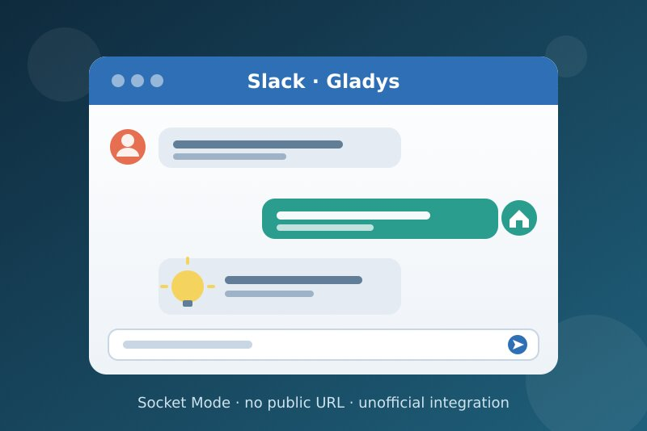
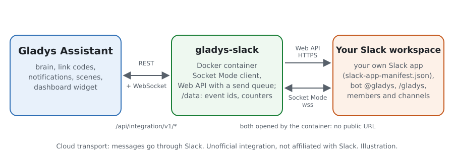
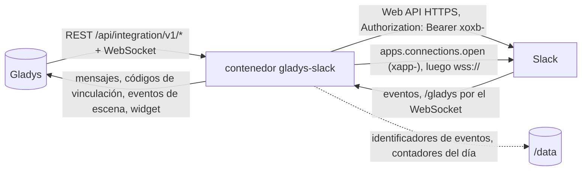
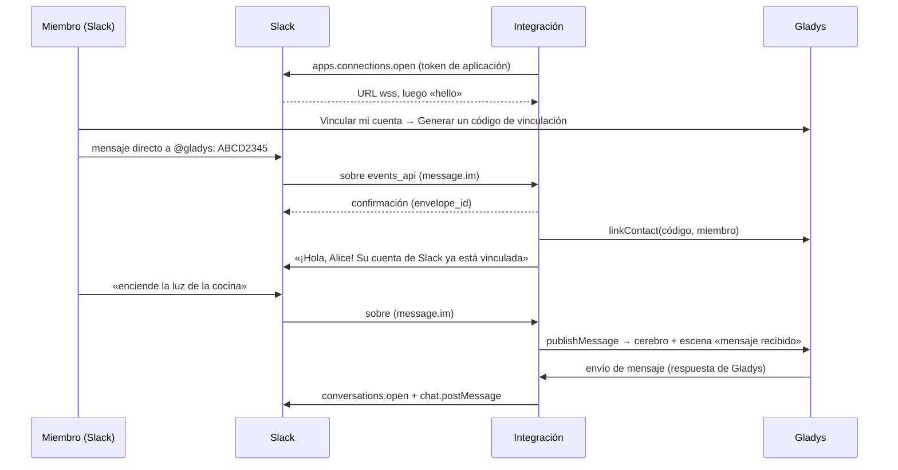
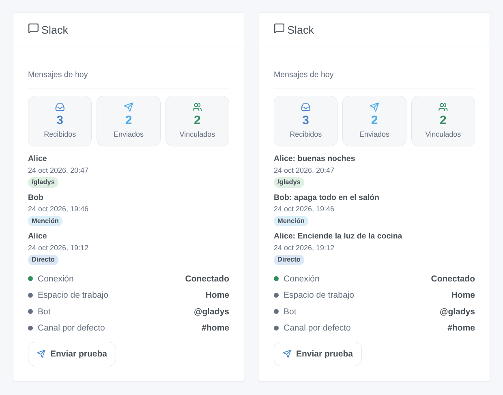

# Gladys Slack

[English](README.md) · [Français](README.fr.md) · [Deutsch](README.de.md) · **Español**

[](LICENSE)
[](https://github.com/William-De71/gladys-slack/releases)
[](https://github.com/William-De71/gladys-slack/actions/workflows/release.yml)
[](https://gladysassistant.com)



Integración externa de [Gladys Assistant](https://gladysassistant.com) para **Slack**: hable con Gladys por mensaje directo con un bot de su propio espacio de trabajo, reciba allí sus notificaciones e imágenes de cámara, y deje que sus escenas reaccionen a los mensajes, a las menciones y a `/gladys`. Usa **Socket Mode**: la integración abre ella misma la conexión con Slack, así que Gladys no necesita ninguna URL pública ni Gladys Plus.

Documentación de usuario: [English](docs/en.md) · [Français](docs/fr.md) · [Deutsch](docs/de.md) · [Español](docs/es.md).

**Integración no oficial, sin relación con Slack Technologies.** **Aún no probada en un espacio de trabajo de Slack real**: se prueba contra un Slack falso (Web API y Socket Mode) construido a partir de la documentación de Slack (docs.slack.dev).

## Funciones

- **Su propia app de Slack**, creada con un clic a partir de [`slack-app-manifest.json`](slack-app-manifest.json) (un enlace rellenado de antemano en la configuración): Socket Mode, un bot `@gladys`, el comando `/gladys`, el conjunto mínimo de permisos que usa el código.
- **Hablar con Gladys**: cada usuario vincula su cuenta de Slack con el código de vinculación de Gladys (enviado al bot por mensaje directo, o `/gladys <código>`); sus mensajes directos llegan entonces a Gladys, que responde en la misma conversación, como la integración nativa de Telegram.
- **Notificaciones e imágenes de cámara** de Gladys para los miembros vinculados, en el mensaje directo del bot.
- **Segura por defecto**: los miembros no vinculados solo reciben una invitación a vincularse (una vez al día), nunca el cerebro ni las escenas; se ignoran los bots, el propio bot, las ediciones, los eventos reenviados y los mensajes de hace más de 5 minutos.
- **4 disparadores de escena** (mensaje recibido, @gladys mencionada, `/gladys` escrito, mensaje no enviado), **1 acción de escena** (enviar un mensaje de Slack a un canal, a un miembro o a un hilo) y **1 widget de panel** (conexión, mensajes del día, últimos mensajes, botón de prueba).
- **Dentro de los límites de Slack**: un mensaje por segundo y por canal, `Retry-After` respetado ante un HTTP 429, cada sobre de Socket Mode confirmado en menos de 3 segundos, reconexión cuando Slack renueva la conexión.
- Cuatro idiomas en todas partes: inglés, francés, alemán, español.

## Cómo funciona





Del código de vinculación a la conversación:



### Transporte

`transports: ["cloud"]`: todo pasa por Slack. La Web API se llama en `https://slack.com/api/` con el token del bot (`xoxb-`) en la cabecera `Authorization`; Socket Mode es un WebSocket que el contenedor abre con Slack mediante una URL de un solo uso pedida con el token de aplicación (`xapp-`). Los mensajes intercambiados con Gladys, y los nombres de los miembros, pasan por tanto por los servidores de Slack. Los tokens son campos `secret` de Gladys, nunca se registran ni se escriben en `/data`; `/data` solo contiene los identificadores de los eventos ya tratados, los miembros ya invitados y los contadores del día.

## Crear la app de Slack

1. En la configuración de la integración, abra **Crear la app Gladys en Slack**: la página de creación de apps de Slack se abre con el manifiesto de abajo ya rellenado. Elija su espacio de trabajo, revise, **Create**.
2. **Basic Information → App-Level Tokens → Generate Token and Scopes**: añada el permiso `connections:write` y copie el token `xapp-`.
3. **Install App → Install to Workspace**, autorice y copie el **Bot User OAuth Token** (`xoxb-`).
4. Pegue los dos tokens en la configuración de la integración y guarde.

Sin el enlace rellenado: [api.slack.com/apps](https://api.slack.com/apps) → **Create New App → From a manifest**, elija el espacio de trabajo y pegue el manifiesto.

### El manifiesto de la app de Slack

El mismo que [`slack-app-manifest.json`](slack-app-manifest.json). Cada permiso sirve a una llamada o a un evento del código: `chat:write` (enviar), `im:write` (abrir el mensaje directo), `im:history` / `channels:history` / `groups:history` (recibir los mensajes directos y los de los canales públicos y privados en los que está el bot), `app_mentions:read` (@gladys), `commands` (`/gladys`), `files:write` (imágenes de cámara), `users:read` (nombres), `channels:read` / `groups:read` (nombres de canales, comprobación del canal por defecto). Sin token de usuario, sin `users:read.email`.

```json
{
  "_metadata": { "major_version": 1 },
  "display_information": {
    "name": "Gladys",
    "description": "Gladys Assistant, the home automation assistant of the house.",
    "background_color": "#2f6fb5"
  },
  "features": {
    "app_home": {
      "home_tab_enabled": false,
      "messages_tab_enabled": true,
      "messages_tab_read_only_enabled": false
    },
    "bot_user": { "display_name": "gladys", "always_online": true },
    "slash_commands": [
      {
        "command": "/gladys",
        "description": "Talk to Gladys, or send a link code",
        "usage_hint": "turn on the kitchen light",
        "should_escape": false
      }
    ]
  },
  "oauth_config": {
    "scopes": {
      "bot": [
        "app_mentions:read",
        "channels:history",
        "channels:read",
        "chat:write",
        "commands",
        "files:write",
        "groups:history",
        "groups:read",
        "im:history",
        "im:write",
        "users:read"
      ]
    }
  },
  "settings": {
    "event_subscriptions": {
      "bot_events": ["app_mention", "message.channels", "message.groups", "message.im"]
    },
    "org_deploy_enabled": false,
    "socket_mode_enabled": true,
    "token_rotation_enabled": false
  }
}
```

La app es una app interna de su espacio de trabajo (nunca distribuida): los límites de 2025 de Slack para las apps comerciales fuera del Marketplace (`conversations.history` a 1 petición por minuto) no se le aplican, y de todos modos la integración no lee el historial (los mensajes llegan como eventos).

## Disparadores, acciones de escena y widget



Las imágenes son **ilustraciones generadas**, dibujadas con el código real del widget a partir de miembros y mensajes inventados, no capturas de pantalla.

**Widget «Slack»**: mensajes recibidos y enviados hoy, miembros vinculados, los 8 últimos mensajes de los miembros vinculados (mensaje directo, mención, `/gladys`, canal; su texto solo con el ajuste del widget **Mostrar el texto de los mensajes**, desactivado por defecto porque un panel puede compartirse; guardados solo en memoria), la conexión, el espacio de trabajo, el bot, el canal por defecto y un botón **Enviar prueba** (al canal por defecto, o a cada miembro vinculado).

**Disparadores de escena**, solo para miembros vinculados a un usuario de Gladys, nunca a causa de una acción de escena:

| Disparador                  | Filtros                                                                                    | Variables                                                                                            |
| --------------------------- | ------------------------------------------------------------------------------------------ | ---------------------------------------------------------------------------------------------------- |
| Mensaje de Slack recibido   | dónde (mensaje directo, público, privado), canal, miembro, usuario de Gladys, texto exacto | texto, identificador y nombre del miembro, usuario de Gladys y nombre, canal, tipo, ts, hilo, enlace |
| Gladys mencionada en Slack  | canal, miembro, usuario de Gladys, texto exacto (tras la mención)                          | los mismos, sin el tipo                                                                              |
| Comando /gladys escrito     | canal, miembro, usuario de Gladys, texto exacto                                            | texto, comando, miembro, usuario de Gladys, identificador y nombre del canal                         |
| Mensaje de Slack no enviado | causa, usuario de Gladys                                                                   | identificador del miembro, usuario de Gladys, causa, código de error de Slack                        |

**Acción de escena** «Enviar un mensaje de Slack»: un identificador de canal (`C…`, el bot debe estar en él) o de miembro (`U…`, mensaje directo), vacío para el canal por defecto; el texto con formato de Slack (`*negrita*`, `<@U…>`, `<https://…|texto>`); un hilo opcional (`{{triggerEvent.data.ts}}` responde al mensaje que inició la escena). Salidas: `ts`, `channel_id`, `link`. Una imagen de cámara pasa por la acción **Enviar una imagen de cámara** de Gladys a un usuario vinculado en Slack.

Ejemplos:

- **@gladys mencionada** en `#casa` con el texto «apaga todo» → apagar todas las luces y luego **Enviar un mensaje de Slack** «Hecho ✅» en el hilo `{{triggerEvent.data.ts}}`.
- **/gladys escrito** con «buenas noches» → la escena de noche, alarma activada.
- **Puerta de entrada abierta** sin nadie en casa → **Enviar un mensaje de Slack** a `#casa`, y una imagen de cámara a los usuarios vinculados.

## Requisitos

- Gladys Assistant **5.3.0** o posterior (widgets de panel y disparadores / acciones de escena, el catálogo de palabras clave/países de Gladys 5.3): las instancias más antiguas no pueden instalar la integración.
- Un espacio de trabajo de Slack donde pueda instalar una app (cualquier plan; en algunos espacios un administrador debe aprobarla).
- Acceso a Internet desde Gladys (solo saliente: ningún puerto que abrir).

## Instalación

- **Desde la tienda**: Integraciones → Slack → Instalar.
- **Desde la URL del repositorio**: Integraciones → Instalar desde una URL → `https://github.com/William-De71/gladys-slack`.
- **Modo desarrollador**: ejecute usted mismo el contenedor con las variables que muestra Gladys (ver Desarrollo).

## Configuración

| Campo                                 | Por defecto | Significado                                                                                                |
| ------------------------------------- | ----------- | ---------------------------------------------------------------------------------------------------------- |
| Token del bot                         | —           | obligatorio, secreto: `xoxb-…` (OAuth & Permissions)                                                       |
| Token de aplicación                   | —           | obligatorio, secreto: `xapp-…` con `connections:write` (Basic Information)                                 |
| Enviar los mensajes directos a Gladys | activado    | desactivado: los mensajes y `/gladys` de los miembros vinculados solo llegan a las escenas                 |
| Canal por defecto                     | —           | identificador de canal (`C…`, `G…`) o de miembro (`U…`) para la acción de escena y el botón de prueba      |
| Idioma del bot                        | automático  | los pocos textos que el bot escribe a los miembros que Gladys aún no conoce (invitación, código rechazado) |

**Probar la conexión** (botón de la configuración) comprueba el token del bot y muestra el espacio de trabajo, el estado de Socket Mode, el canal por defecto (y si el bot está en él) y el número de miembros vinculados.

## Uso

1. Cree la app de Slack (arriba) y pegue los dos tokens.
2. Cada usuario: **Vincular mi cuenta → Generar un código de vinculación** en la configuración de la integración y luego envíe el código a `@gladys` en Slack (Aplicaciones → Gladys → Mensajes), o escriba `/gladys <código>`.
3. Escriba a `@gladys`: Gladys responde. Invite al bot (`/invite @gladys`) a los canales donde los mensajes y las menciones deban activar escenas.
4. Añada el widget a un panel; cree escenas con los disparadores y la acción.

## Desarrollo

```bash
npm install
npm test                       # node --test, un Slack falso en 127.0.0.1, nunca la red
npm run lint                   # ESLint
npm run format:check           # Prettier
npm run coverage               # node --test con la cobertura de src/
npx github:GladysAssistant/integration-store . --skip-image-check
node scripts/fake-slack.mjs 18790   # el Slack falso (Web API + Socket Mode) en 127.0.0.1
scripts/check-simulator.sh     # la integración real contra el Slack falso en otro proceso
scripts/build-cover.sh         # cover.jpg a partir de docs/assets/cover.svg
docs/illustrations/render.sh   # docs/assets/widgets.<lang>.png
```

En local, el SDK lee `GLADYS_HOST_API_URL`, `GLADYS_INTEGRATION_TOKEN` y `GLADYS_INTEGRATION_SELECTOR` (que Gladys muestra en modo desarrollador). `SLACK_API_URL=http://127.0.0.1:18790/api/` dirige la integración hacia el Slack falso (solo se aceptan `slack.com` o una dirección local: un token nunca va a otro sitio). `DEBUG=gladys-integration-sdk` muestra los registros del SDK; `LOG_LEVEL=debug` muestra por qué se ignoró un evento (nunca el texto de un mensaje a un nivel inferior).

Las pruebas cubren las conversiones de texto (entidades y menciones de Slack, escape, mensajes largos, imágenes), la clasificación de los sobres (bots, ediciones, subtipos, menciones en un mensaje directo), la configuración, `/data`, el cliente de la Web API (cabecera bearer, errores `{ok:false}`, 429 y `Retry-After`, un mensaje por segundo y por canal, hosts permitidos), Socket Mode (hello ausente, ping sin respuesta, confirmaciones con contenido) y toda la integración contra el Gladys falso del SDK y el Slack falso: vinculación, conversación, desconocidos, duplicados, renovación, corte, Socket Mode desactivado, 429, imágenes, fallos, la acción de escena, el widget, el botón de configuración. `test/structure.test.js` fija cada clave que guardan los usuarios. `npm run coverage` indica cerca del 93 % de las líneas de `src/` cubiertas (0.1.0).

## Proceso de publicación


Cada fusión en `main` ejecuta la CI y luego calcula la versión a partir de los [Conventional Commits](https://www.conventionalcommits.org/) desde la última etiqueta: `feat` → menor, `fix` / `perf` → parche, `!` o `BREAKING CHANGE` → mayor (una menor por debajo de 1.0.0); `docs`, `chore`, `ci`, `test`, `style`, `refactor`, `build` solos no publican nada. Se genera la sección del changelog, se envía la etiqueta, se construye la imagen multiarquitectura, luego `main` recibe el commit de publicación, se crea la GitHub Release y un último job comprueba la imagen pública, el validador de la tienda y el topic.

- El título del pull request se convierte en el commit squash y luego en la línea del changelog: escríbalo en inglés, para el usuario (`pr-title.yml` lo comprueba). No edite nunca `CHANGELOG.md` a mano.
- La 1.0.0 es una decisión: Actions → Release → Run workflow con `release-as: 1.0.0`. `dry-run` muestra la versión y las notas sin publicar nada.
- **Rama protegida**: la publicación envía su commit a `main` con `GITHUB_TOKEN`. El ruleset `protect-main` (sin borrado ni force-push) lo deja pasar; una regla más estricta (pull request obligatorio, status checks) requeriría añadir GitHub Actions a su lista de excepciones, o una GitHub App.
- Tras la primera publicación, haga público el paquete de `ghcr.io` (Package settings → Change visibility), o Gladys no podrá descargarlo.

## Solución de problemas

Vea [docs/es.md](docs/es.md#solución-de-problemas). Informe de los problemas con las versiones de Gladys y de la integración, el mensaje de **Probar la conexión** y los registros con `DEBUG=gladys-integration-sdk`. No pegue nunca un token ni mensajes privados.

## Contribuir

Las issues y los pull requests son bienvenidos. Ejecute `npm run format:check && npm run lint && npm test` antes de abrir un pull request y mantenga sin cambios cada clave guardada (vea [CLAUDE.md](CLAUDE.md)). Una prueba en un espacio de trabajo real (registros sin tokens) ayuda más que nada.

## Seguridad

Vea [SECURITY.md](SECURITY.md): informe de las vulnerabilidades de forma privada. Los tokens son campos `secret`, enviados solo a `slack.com` en una cabecera, nunca registrados ni escritos en `/data`. El texto de los mensajes nunca se registra (solo sus identificadores, en el nivel debug). Solo los miembros vinculados llegan al cerebro de Gladys, y a través de él a la autoridad de su usuario de Gladys: vincule solo a personas de confianza.

## Capturas de pantalla pendientes

Las imágenes de arriba son ilustraciones, no capturas de pantalla. Las capturas reales irán en `docs/assets/screenshots/` (PNG, 1280 × 800): `configuration.png` (los tokens y las secciones de ayuda), `link.png` (el código de vinculación enviado al bot en Slack), `conversation.png` (una conversación con Gladys en Slack), `slash-command.png` (`/gladys` y su respuesta privada), `scene-mention.png` (el disparador «Gladys mencionada en Slack» en una escena).

## Límites conocidos

- Nunca probada en un espacio de trabajo real: los contenidos, el plazo de confirmación y el comportamiento de los pings de Socket Mode siguen la documentación y el SDK oficial de Slack, no una sesión real.
- Los mensajes directos de grupo (varias personas con el bot) no se tratan; las reacciones, los botones y los archivos enviados por los miembros no se leen (un archivo solo activa el disparador, con su texto).
- La respuesta de Gladys va siempre al mensaje directo, incluso para `/gladys` escrito en un canal.
- Un código de vinculación caduca a los 15 minutos (Gladys); la pestaña Mensajes debe estar activada en la app (ya lo está en el manifiesto).
- Slack conserva el historial de mensajes según el plan del espacio de trabajo; la integración no guarda nada.

## Licencia

[Apache License 2.0](LICENSE) — vea también [NOTICE](NOTICE). Slack es una marca de Slack Technologies, LLC; este proyecto no tiene relación con ella. `callemand/gladys-slack` (2018) es un módulo de Gladys 3 sin relación. Gracias a la documentación y al SDK de Gladys, a la documentación de Slack y a las integraciones de mensajería de guim31 por el principio de vinculación (vea NOTICE).
