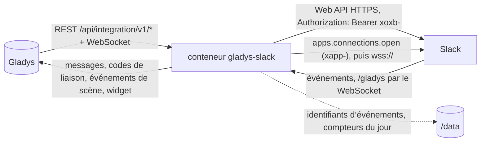
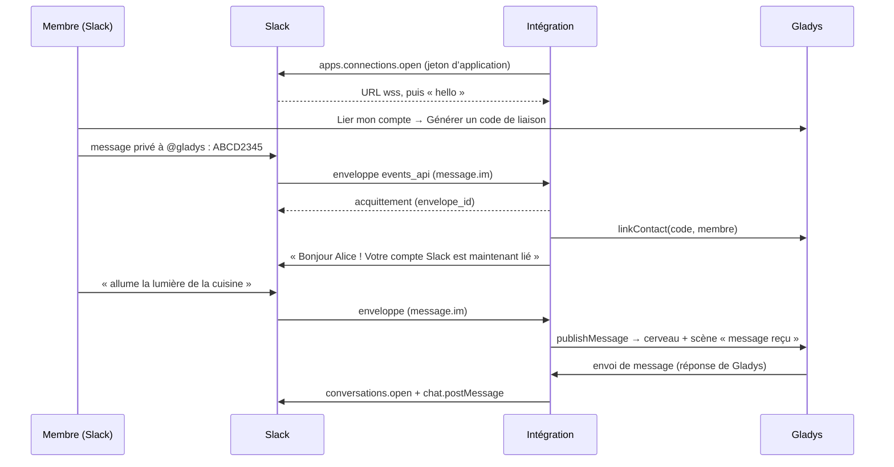
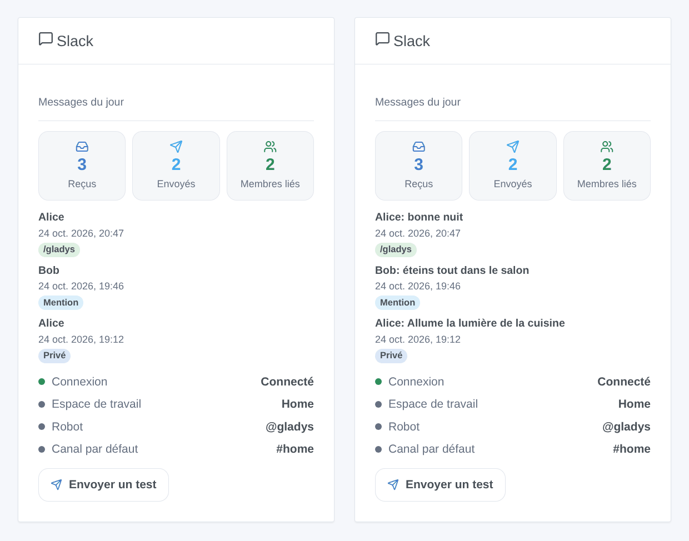

# Gladys Slack

[English](README.md) · **Français** · [Deutsch](README.de.md) · [Español](README.es.md)

[](LICENSE)
[](https://github.com/William-De71/gladys-slack/releases)
[](https://github.com/William-De71/gladys-slack/actions/workflows/release.yml)
[](https://gladysassistant.com)


Intégration externe [Gladys Assistant](https://gladysassistant.com) pour **Slack** : discutez avec Gladys en message privé avec un robot de votre propre espace de travail, recevez-y ses notifications et ses images de caméra, et laissez vos scènes réagir aux messages, aux mentions et à `/gladys`. Elle utilise le **Socket Mode** : l’intégration ouvre elle-même la connexion vers Slack, Gladys n’a donc besoin ni d’URL publique ni de Gladys Plus.

Documentation utilisateur : [English](docs/en.md) · [Français](docs/fr.md) · [Deutsch](docs/de.md) · [Español](docs/es.md).

**Intégration non officielle, sans lien avec Slack Technologies.** **Pas encore testée dans un vrai espace de travail Slack** : elle est testée contre un faux Slack (Web API et Socket Mode) construit d’après la documentation de Slack (docs.slack.dev).

## Fonctionnalités

- **Votre propre app Slack**, créée en un clic depuis [`slack-app-manifest.json`](slack-app-manifest.json) (un lien prérempli dans la configuration) : Socket Mode, un robot `@gladys`, la commande `/gladys`, le plus petit ensemble de portées que le code utilise.
- **Discuter avec Gladys** : chaque utilisateur lie son compte Slack avec le code de liaison de Gladys (envoyé au robot en message privé, ou `/gladys <code>`) ; ses messages privés vont alors à Gladys, qui répond dans la même conversation, comme l’intégration native Telegram.
- **Notifications et images de caméra** de Gladys vers les membres liés, dans le message privé du robot.
- **Sûre par défaut** : les membres non liés reçoivent seulement une invitation à se lier (une fois par jour), jamais le cerveau ni les scènes ; les robots, le robot lui-même, les modifications, les événements renvoyés et les messages de plus de 5 minutes sont ignorés.
- **4 déclencheurs de scène** (message reçu, @gladys mentionnée, `/gladys` tapée, message non envoyé), **1 action de scène** (envoyer un message Slack dans un canal, à un membre ou dans un fil) et **1 widget de tableau de bord** (connexion, messages du jour, derniers messages, bouton de test).
- **Dans les limites de Slack** : un message par seconde et par canal, `Retry-After` respecté sur un HTTP 429, chaque enveloppe Socket Mode acquittée en moins de 3 secondes, reconnexion quand Slack renouvelle la connexion.
- Quatre langues partout : anglais, français, allemand, espagnol.

## Fonctionnement




Du code de liaison à la conversation :



### Transport

`transports: ["cloud"]` : tout passe par Slack. La Web API est appelée sur `https://slack.com/api/` avec le jeton du robot (`xoxb-`) dans l’en-tête `Authorization` ; le Socket Mode est un WebSocket que le conteneur ouvre vers Slack avec une URL à usage unique demandée avec le jeton d’application (`xapp-`). Les messages échangés avec Gladys, et les noms des membres, passent donc par les serveurs de Slack. Les jetons sont des champs `secret` de Gladys, jamais journalisés ni écrits dans `/data` ; `/data` ne contient que les identifiants des événements déjà traités, les membres déjà invités et les compteurs du jour.

## Créer l’app Slack

1. Dans la configuration de l’intégration, ouvrez **Créer l’app Gladys dans Slack** : la page de création d’app de Slack s’ouvre avec le manifeste ci-dessous déjà rempli. Choisissez votre espace de travail, vérifiez, **Create**.
2. **Basic Information → App-Level Tokens → Generate Token and Scopes** : ajoutez la portée `connections:write`, copiez le jeton `xapp-`.
3. **Install App → Install to Workspace**, autorisez, puis copiez le **Bot User OAuth Token** (`xoxb-`).
4. Collez les deux jetons dans la configuration de l’intégration et enregistrez.

Sans le lien prérempli : [api.slack.com/apps](https://api.slack.com/apps) → **Create New App → From a manifest**, choisissez l’espace de travail, collez le manifeste.

### Le manifeste de l’app Slack

Le même que [`slack-app-manifest.json`](slack-app-manifest.json). Chaque portée sert un appel ou un événement du code : `chat:write` (envoyer), `im:write` (ouvrir le message privé), `im:history` / `channels:history` / `groups:history` (recevoir les messages privés et ceux des canaux publics et privés où se trouve le robot), `app_mentions:read` (@gladys), `commands` (`/gladys`), `files:write` (images de caméra), `users:read` (noms), `channels:read` / `groups:read` (noms des canaux, vérification du canal par défaut). Pas de jeton utilisateur, pas de `users:read.email`.

```json
{
  "_metadata": { "major_version": 1 },
  "display_information": {
    "name": "Gladys",
    "description": "Gladys Assistant, the home automation assistant of the house.",
    "background_color": "#2f6fb5"
  },
  "features": {
    "app_home": {
      "home_tab_enabled": false,
      "messages_tab_enabled": true,
      "messages_tab_read_only_enabled": false
    },
    "bot_user": { "display_name": "gladys", "always_online": true },
    "slash_commands": [
      {
        "command": "/gladys",
        "description": "Talk to Gladys, or send a link code",
        "usage_hint": "turn on the kitchen light",
        "should_escape": false
      }
    ]
  },
  "oauth_config": {
    "scopes": {
      "bot": [
        "app_mentions:read",
        "channels:history",
        "channels:read",
        "chat:write",
        "commands",
        "files:write",
        "groups:history",
        "groups:read",
        "im:history",
        "im:write",
        "users:read"
      ]
    }
  },
  "settings": {
    "event_subscriptions": {
      "bot_events": ["app_mention", "message.channels", "message.groups", "message.im"]
    },
    "org_deploy_enabled": false,
    "socket_mode_enabled": true,
    "token_rotation_enabled": false
  }
}
```

L’app est une app interne de votre espace de travail (jamais distribuée) : les limites de débit 2025 de Slack pour les apps commerciales hors Marketplace (`conversations.history` à 1 requête par minute) ne s’y appliquent pas, et l’intégration ne lit de toute façon pas l’historique (les messages arrivent par événements).

## Déclencheurs, actions de scène et widget



Les images sont des **illustrations générées**, dessinées par le vrai code du widget sur des membres et des messages inventés, pas des captures d’écran.

**Widget « Slack »** : messages reçus et envoyés aujourd’hui, membres liés, les 8 derniers messages des membres liés (message privé, mention, `/gladys`, canal ; leur texte seulement avec le réglage du widget **Afficher le texte des messages**, désactivé par défaut car un tableau de bord peut être partagé ; gardés en mémoire uniquement), la connexion, l’espace de travail, le robot, le canal par défaut, et un bouton **Envoyer un test** (vers le canal par défaut, ou vers chaque membre lié).

**Déclencheurs de scène**, pour les membres liés à un utilisateur Gladys uniquement, jamais à cause d’une action de scène :

| Déclencheur                 | Filtres                                                                           | Variables                                                                                     |
| --------------------------- | --------------------------------------------------------------------------------- | --------------------------------------------------------------------------------------------- |
| Message Slack reçu          | où (message privé, public, privé), canal, membre, utilisateur Gladys, texte exact | texte, identifiant et nom du membre, utilisateur Gladys et prénom, canal, type, ts, fil, lien |
| Gladys mentionnée sur Slack | canal, membre, utilisateur Gladys, texte exact (après la mention)                 | les mêmes, sans le type                                                                       |
| Commande /gladys tapée      | canal, membre, utilisateur Gladys, texte exact                                    | texte, commande, membre, utilisateur Gladys, identifiant et nom du canal                      |
| Message Slack non envoyé    | cause, utilisateur Gladys                                                         | identifiant du membre, utilisateur Gladys, cause, code d’erreur Slack                         |

**Action de scène** « Envoyer un message Slack » : un identifiant de canal (`C…`, le robot doit y être) ou de membre (`U…`, message privé), vide pour le canal par défaut ; le texte en mise en forme Slack (`*gras*`, `<@U…>`, `<https://…|libellé>`) ; un fil facultatif (`{{triggerEvent.data.ts}}` répond au message qui a lancé la scène). Sorties : `ts`, `channel_id`, `link`. Une image de caméra passe par l’action **Envoyer une image de caméra** de Gladys vers un utilisateur lié sur Slack.

Exemples :

- **@gladys mentionnée** dans `#maison` avec le texte « éteins tout » → éteindre toutes les lumières, puis **Envoyer un message Slack** « C’est fait ✅ » dans le fil `{{triggerEvent.data.ts}}`.
- **/gladys tapée** avec « bonne nuit » → la scène de nuit, alarme activée.
- **Porte d’entrée ouverte** alors que personne n’est là → **Envoyer un message Slack** dans `#maison`, et une image de caméra aux utilisateurs liés.

## Prérequis

- Gladys Assistant **5.3.0** ou plus récent (widgets de tableau de bord et déclencheurs / actions de scène, le catalogue mots-clés/pays de Gladys 5.3) : les instances plus anciennes ne peuvent pas installer l’intégration.
- Un espace de travail Slack où vous pouvez installer une app (n’importe quelle offre ; sur certains espaces, un administrateur doit l’approuver).
- Un accès Internet depuis Gladys (sortant uniquement : aucun port à ouvrir).

## Installation

- **Depuis le store** : Intégrations → Slack → Installer.
- **Depuis l’URL du dépôt** : Intégrations → Installer depuis une URL → `https://github.com/William-De71/gladys-slack`.
- **Mode développeur** : lancez vous-même le conteneur avec les variables que Gladys affiche (voir Développement).

## Configuration

| Champ                                | Défaut      | Rôle                                                                                                          |
| ------------------------------------ | ----------- | ------------------------------------------------------------------------------------------------------------- |
| Jeton du robot                       | —           | obligatoire, secret : `xoxb-…` (OAuth & Permissions)                                                          |
| Jeton d’application                  | —           | obligatoire, secret : `xapp-…` avec `connections:write` (Basic Information)                                   |
| Envoyer les messages privés à Gladys | activé      | désactivé : les messages et `/gladys` des membres liés n’atteignent que les scènes                            |
| Canal par défaut                     | —           | identifiant de canal (`C…`, `G…`) ou de membre (`U…`) pour l’action de scène et le bouton de test             |
| Langue du robot                      | automatique | les quelques textes que le robot écrit aux membres que Gladys ne connaît pas encore (invitation, code refusé) |

**Tester la connexion** (bouton de la configuration) vérifie le jeton du robot, affiche l’espace de travail, l’état du Socket Mode, le canal par défaut (et si le robot y est) et le nombre de membres liés.

## Utilisation

1. Créez l’app Slack (ci-dessus) et collez les deux jetons.
2. Chaque utilisateur : **Lier mon compte → Générer un code de liaison** dans la configuration de l’intégration, puis envoyez le code à `@gladys` dans Slack (Apps → Gladys → Messages), ou tapez `/gladys <code>`.
3. Écrivez à `@gladys` : Gladys répond. Invitez le robot (`/invite @gladys`) dans les canaux où les messages et les mentions doivent déclencher des scènes.
4. Ajoutez le widget à un tableau de bord ; construisez des scènes avec les déclencheurs et l’action.

## Développement

```bash
npm install
npm test                       # node --test, un faux Slack sur 127.0.0.1, jamais le réseau
npm run lint                   # ESLint
npm run format:check           # Prettier
npm run coverage               # node --test avec la couverture de src/
npx github:GladysAssistant/integration-store . --skip-image-check
node scripts/fake-slack.mjs 18790   # le faux Slack (Web API + Socket Mode) sur 127.0.0.1
scripts/check-simulator.sh     # la vraie intégration contre le faux Slack dans un autre processus
scripts/build-cover.sh         # cover.jpg depuis docs/assets/cover.svg
docs/illustrations/render.sh   # docs/assets/widgets.<lang>.png
```

En local, le SDK lit `GLADYS_HOST_API_URL`, `GLADYS_INTEGRATION_TOKEN` et `GLADYS_INTEGRATION_SELECTOR` (fournis par Gladys en mode développeur). `SLACK_API_URL=http://127.0.0.1:18790/api/` dirige l’intégration vers le faux Slack (seuls `slack.com` ou une adresse locale sont acceptés : un jeton ne part jamais ailleurs). `DEBUG=gladys-integration-sdk` affiche les journaux du SDK ; `LOG_LEVEL=debug` affiche pourquoi un événement a été ignoré (jamais le texte d’un message à un niveau inférieur).

Les tests couvrent les conversions de texte (entités et mentions Slack, échappement, messages longs, images), le classement des enveloppes (robots, modifications, sous-types, mentions en message privé), la configuration, `/data`, le client Web API (en-tête bearer, erreurs `{ok:false}`, 429 et `Retry-After`, un message par seconde et par canal, hôtes autorisés), le Socket Mode (hello absent, ping sans réponse, acquittements avec contenu) et toute l’intégration contre le faux Gladys du SDK et le faux Slack : liaison, conversation, inconnus, doublons, renouvellement, coupure, Socket Mode désactivé, 429, images, échecs, l’action de scène, le widget, le bouton de configuration. `test/structure.test.js` fige chaque clé que les utilisateurs stockent. `npm run coverage` indique environ 93 % des lignes de `src/` couvertes (0.1.0).

## Processus de release


Chaque fusion sur `main` lance la CI, puis calcule la version depuis les [Conventional Commits](https://www.conventionalcommits.org/) depuis le dernier tag : `feat` → mineure, `fix` / `perf` → correctif, `!` ou `BREAKING CHANGE` → majeure (une mineure tant qu’on est sous 1.0.0) ; `docs`, `chore`, `ci`, `test`, `style`, `refactor`, `build` seuls ne publient rien. La section du changelog est générée, le tag poussé, l’image multi-architecture construite, puis `main` reçoit le commit de release, la GitHub Release est créée et un dernier job vérifie l’image publique, le validateur du store et le topic.

- Le titre de la pull request devient le commit squash, puis la ligne du changelog : écrivez-le en anglais, pour l’utilisateur (`pr-title.yml` le vérifie). Ne modifiez jamais `CHANGELOG.md` à la main.
- La 1.0.0 est une décision : Actions → Release → Run workflow avec `release-as: 1.0.0`. `dry-run` affiche la version et les notes sans rien publier.
- **Branche protégée** : la release pousse son commit sur `main` avec `GITHUB_TOKEN`. Le ruleset `protect-main` (ni suppression, ni force-push) le laisse passer ; une règle plus stricte (pull request obligatoire, status checks) demanderait d’ajouter GitHub Actions à sa liste de contournement, ou une GitHub App.
- Après la première release, rendez public le package `ghcr.io` (Package settings → Change visibility), sinon Gladys ne peut pas le télécharger.

## Dépannage

Voir [docs/fr.md](docs/fr.md#dépannage). Signalez un problème avec les versions de Gladys et de l’intégration, le message de **Tester la connexion** et les journaux avec `DEBUG=gladys-integration-sdk`. Ne collez jamais un jeton ni des messages privés.

## Contribuer

Les issues et les pull requests sont les bienvenues. Lancez `npm run format:check && npm run lint && npm test` avant d’ouvrir une pull request, et gardez chaque clé stockée inchangée (voir [CLAUDE.md](CLAUDE.md)). Un test dans un vrai espace de travail (journaux sans jetons) aide plus que tout.

## Sécurité

Voir [SECURITY.md](SECURITY.md) : signalez les vulnérabilités en privé. Les jetons sont des champs `secret`, envoyés uniquement à `slack.com` dans un en-tête, jamais journalisés ni écrits dans `/data`. Le texte des messages n’est jamais journalisé (seulement leurs identifiants, au niveau debug). Seuls les membres liés atteignent le cerveau de Gladys, et à travers lui l’autorité de leur utilisateur Gladys : ne liez que des personnes de confiance.

## Captures d’écran à venir

Les images ci-dessus sont des illustrations, pas des captures d’écran. Les vraies captures iront dans `docs/assets/screenshots/` (PNG, 1280 × 800) : `configuration.png` (les jetons et les sections d’aide), `link.png` (le code de liaison envoyé au robot dans Slack), `conversation.png` (une conversation avec Gladys dans Slack), `slash-command.png` (`/gladys` et sa réponse privée), `scene-mention.png` (le déclencheur « Gladys mentionnée sur Slack » dans une scène).

## Limites connues

- Jamais testée dans un vrai espace de travail : les contenus, le délai d’acquittement et le comportement des pings du Socket Mode suivent la documentation et le SDK officiel de Slack, pas une vraie session.
- Les messages de groupe (plusieurs personnes avec le robot) ne sont pas gérés ; les réactions, les boutons et les fichiers envoyés par les membres ne sont pas lus (un fichier ne déclenche que le déclencheur, avec son texte).
- La réponse de Gladys va toujours dans le message privé, même pour `/gladys` tapée dans un canal.
- Un code de liaison expire au bout de 15 minutes (Gladys) ; l’onglet Messages doit être activé dans l’app (déjà le cas dans le manifeste).
- Slack conserve l’historique des messages selon l’offre de l’espace de travail ; l’intégration, elle, ne garde rien.

## Licence

[Apache License 2.0](LICENSE) — voir aussi [NOTICE](NOTICE). Slack est une marque de Slack Technologies, LLC ; ce projet n’a aucun lien avec elle. `callemand/gladys-slack` (2018) est un module Gladys 3 sans rapport. Merci à la documentation et au SDK de Gladys, à la documentation de Slack, et aux intégrations de messagerie de guim31 pour le principe de liaison (voir NOTICE).
