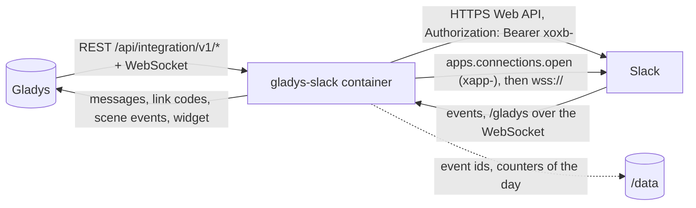
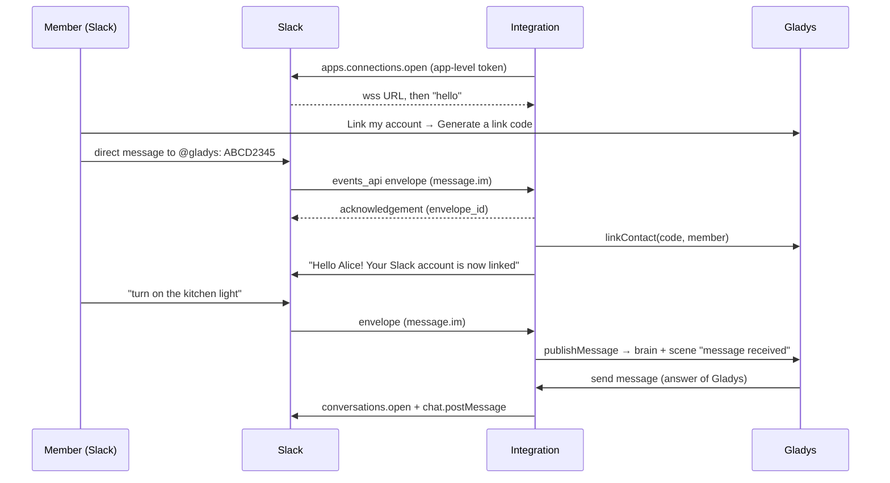
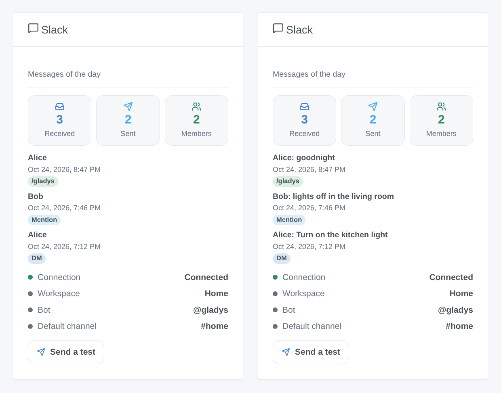

# Gladys Slack

**English** · [Français](README.fr.md) · [Deutsch](README.de.md) · [Español](README.es.md)

[](LICENSE)
[](https://github.com/William-De71/gladys-slack/releases)
[](https://github.com/William-De71/gladys-slack/actions/workflows/release.yml)
[](https://gladysassistant.com)


[Gladys Assistant](https://gladysassistant.com) external integration for **Slack**: talk to Gladys in a direct message to a bot of your own workspace, receive her notifications and camera images there, and let your scenes react to messages, mentions and `/gladys`. It uses **Socket Mode**: the integration opens the connection to Slack itself, so Gladys needs no public URL and no Gladys Plus.

User documentation: [English](docs/en.md) · [Français](docs/fr.md) · [Deutsch](docs/de.md) · [Español](docs/es.md).

**Unofficial integration, not affiliated with Slack Technologies.** **Not tested in a real Slack workspace yet**: it is tested against a fake Slack (Web API and Socket Mode) built from the documentation of Slack (docs.slack.dev).

## Features

- **Your own Slack app**, created in one click from [`slack-app-manifest.json`](slack-app-manifest.json) (a prefilled link in the configuration): Socket Mode, a bot `@gladys`, the `/gladys` command, the smallest set of scopes the code uses.
- **Talk to Gladys**: each user links their Slack account with the link code of Gladys (sent to the bot in a direct message, or `/gladys <code>`); their direct messages then go to Gladys, who answers in the same conversation, like the native Telegram integration.
- **Notifications and camera images** of Gladys to linked members, in the direct message of the bot.
- **Safe by default**: members who are not linked only get an invitation to link (once a day), never the brain nor the scenes; bots, the bot itself, edits, re-delivered events and messages older than 5 minutes are ignored.
- **4 scene triggers** (message received, @gladys mentioned, `/gladys` typed, message not sent), **1 scene action** (send a Slack message to a channel, a member or a thread) and **1 dashboard widget** (connection, messages of the day, last messages, test button).
- **Within the limits of Slack**: one message per second and per channel, `Retry-After` respected on HTTP 429, every Socket Mode envelope acknowledged within 3 seconds, reconnection when Slack refreshes the connection.
- Four languages everywhere: English, French, German, Spanish.

## How it works




From the link code to a conversation:



### Transport

`transports: ["cloud"]`: everything goes through Slack. The Web API is called on `https://slack.com/api/` with the bot token (`xoxb-`) in the `Authorization` header; Socket Mode is a WebSocket the container opens to Slack with a single-use URL asked with the app-level token (`xapp-`). The messages exchanged with Gladys, and the names of the members, therefore go through the servers of Slack. The tokens are `secret` fields of Gladys, never logged nor written to `/data`; `/data` only holds the ids of the events already handled, the members already invited and the counters of the day.

## Create the Slack app

1. In the configuration of the integration, open **Create the Gladys app in Slack**: the app creation page of Slack opens with the manifest below already filled in. Choose your workspace, check, **Create**.
2. **Basic Information → App-Level Tokens → Generate Token and Scopes**: add the `connections:write` scope, copy the `xapp-` token.
3. **Install App → Install to Workspace**, allow, then copy the **Bot User OAuth Token** (`xoxb-`).
4. Paste both tokens in the configuration of the integration and save.

Without the prefilled link: [api.slack.com/apps](https://api.slack.com/apps) → **Create New App → From a manifest**, pick the workspace, paste the manifest.

### The Slack app manifest

The same as [`slack-app-manifest.json`](slack-app-manifest.json). Each scope serves one call or one event of the code: `chat:write` (send), `im:write` (open the direct message), `im:history` / `channels:history` / `groups:history` (receive the messages of direct messages, public and private channels the bot is in), `app_mentions:read` (@gladys), `commands` (`/gladys`), `files:write` (camera images), `users:read` (names), `channels:read` / `groups:read` (channel names, check of the default channel). No user token, no `users:read.email`.

```json
{
  "_metadata": { "major_version": 1 },
  "display_information": {
    "name": "Gladys",
    "description": "Gladys Assistant, the home automation assistant of the house.",
    "background_color": "#2f6fb5"
  },
  "features": {
    "app_home": {
      "home_tab_enabled": false,
      "messages_tab_enabled": true,
      "messages_tab_read_only_enabled": false
    },
    "bot_user": { "display_name": "gladys", "always_online": true },
    "slash_commands": [
      {
        "command": "/gladys",
        "description": "Talk to Gladys, or send a link code",
        "usage_hint": "turn on the kitchen light",
        "should_escape": false
      }
    ]
  },
  "oauth_config": {
    "scopes": {
      "bot": [
        "app_mentions:read",
        "channels:history",
        "channels:read",
        "chat:write",
        "commands",
        "files:write",
        "groups:history",
        "groups:read",
        "im:history",
        "im:write",
        "users:read"
      ]
    }
  },
  "settings": {
    "event_subscriptions": {
      "bot_events": ["app_mention", "message.channels", "message.groups", "message.im"]
    },
    "org_deploy_enabled": false,
    "socket_mode_enabled": true,
    "token_rotation_enabled": false
  }
}
```

The app is an internal app of your workspace (never distributed): the 2025 rate limits of Slack for commercial apps outside the Marketplace (`conversations.history` at 1 request a minute) do not apply to it, and the integration does not read the history anyway (messages arrive as events).

## Scene triggers, actions and widget



The images are **generated illustrations**, drawn from the real widget code on made-up members and messages, not screenshots.

**Widget “Slack”**: messages received and sent today, linked members, the last 8 messages of linked members (direct message, mention, `/gladys`, channel; their text only with the widget setting **Show the text of the messages**, off by default since a dashboard can be shared; kept in memory only), the connection, the workspace, the bot, the default channel, and a **Send a test** button (to the default channel, or to every linked member).

**Scene triggers**, for members linked to a Gladys user only, never because of a scene action:

| Trigger                   | Filters                                                                           | Variables                                                                             |
| ------------------------- | --------------------------------------------------------------------------------- | ------------------------------------------------------------------------------------- |
| Slack message received    | where (direct message, public, private), channel, member, Gladys user, exact text | text, member ID and name, Gladys user and first name, channel, type, ts, thread, link |
| Gladys mentioned on Slack | channel, member, Gladys user, exact text (after the mention)                      | the same, without the type                                                            |
| /gladys command typed     | channel, member, Gladys user, exact text                                          | text, command, member, Gladys user, channel ID and name                               |
| Slack message not sent    | reason, Gladys user                                                               | member ID, Gladys user, reason, Slack error code                                      |

**Scene action** “Send a Slack message”: a channel ID (`C…`, the bot must be in it) or a member ID (`U…`, direct message), empty for the default channel; the text in Slack formatting (`*bold*`, `<@U…>`, `<https://…|label>`); an optional thread (`{{triggerEvent.data.ts}}` answers the message that started the scene). Outputs: `ts`, `channel_id`, `link`. A camera snapshot goes through the **Send a camera image** action of Gladys to a user linked on Slack.

Examples:

- **@gladys mentioned** in `#home` with the text “lights off” → turn off every light, then **Send a Slack message** “Done ✅” in the thread `{{triggerEvent.data.ts}}`.
- **/gladys typed** with “goodnight” → the night scene, alarm on.
- **Front door opened** while nobody is home → **Send a Slack message** to `#home`, and a camera image to the linked users.

## Requirements

- Gladys Assistant **5.3.0** or later (dashboard widgets and scene triggers / actions, the catalog keywords/countries of Gladys 5.3): older instances cannot install the integration.
- A Slack workspace where you may install an app (any plan; on some workspaces an admin must approve it).
- Internet access from Gladys (outgoing only: no port to open).

## Installation

- **From the store**: Integrations → Slack → Install.
- **From the repository URL**: Integrations → Install from a URL → `https://github.com/William-De71/gladys-slack`.
- **Developer mode**: run the container yourself with the variables Gladys shows (see Development).

## Configuration

| Field                          | Default   | Meaning                                                                                     |
| ------------------------------ | --------- | ------------------------------------------------------------------------------------------- |
| Bot token                      | —         | required, secret: `xoxb-…` (OAuth & Permissions)                                            |
| App-level token                | —         | required, secret: `xapp-…` with `connections:write` (Basic Information)                     |
| Send direct messages to Gladys | on        | off: messages and `/gladys` of linked members only reach the scenes                         |
| Default channel                | —         | channel ID (`C…`, `G…`) or member ID (`U…`) for the scene action and the test button        |
| Language of the bot            | automatic | the few texts the bot writes to members Gladys does not know yet (invitation, refused code) |

**Test the connection** (configuration button) checks the bot token, shows the workspace, the state of Socket Mode, the default channel (and whether the bot is in it) and the number of linked members.

## Usage

1. Create the Slack app (above) and paste both tokens.
2. Each user: **Link my account → Generate a link code** in the configuration of the integration, then send the code to `@gladys` in Slack (Apps → Gladys → Messages), or type `/gladys <code>`.
3. Write to `@gladys`: Gladys answers. Invite the bot (`/invite @gladys`) in the channels where messages and mentions should trigger scenes.
4. Add the widget to a dashboard; build scenes with the triggers and the action.

## Development

```bash
npm install
npm test                       # node --test, a fake Slack on 127.0.0.1, never the network
npm run lint                   # ESLint
npm run format:check           # Prettier
npm run coverage               # node --test with coverage of src/
npx github:GladysAssistant/integration-store . --skip-image-check
node scripts/fake-slack.mjs 18790   # the fake Slack (Web API + Socket Mode) on 127.0.0.1
scripts/check-simulator.sh     # the real integration against the fake Slack in another process
scripts/build-cover.sh         # cover.jpg from docs/assets/cover.svg
docs/illustrations/render.sh   # docs/assets/widgets.<lang>.png
```

Locally, the SDK reads `GLADYS_HOST_API_URL`, `GLADYS_INTEGRATION_TOKEN` and `GLADYS_INTEGRATION_SELECTOR` (given by Gladys in developer mode). `SLACK_API_URL=http://127.0.0.1:18790/api/` points the integration at the fake Slack (only `slack.com` or a local address is accepted: a token never goes elsewhere). `DEBUG=gladys-integration-sdk` shows the SDK logs; `LOG_LEVEL=debug` shows why an event was ignored (never the text of a message at a lower level).

The tests cover the text conversions (Slack entities and mentions, escaping, long messages, images), the classification of the envelopes (bots, edits, subtypes, mentions in a DM), the configuration, `/data`, the Web API client (bearer header, `{ok:false}` errors, 429 and `Retry-After`, one message per second and per channel, allowed hosts), Socket Mode (hello timeout, ping timeout, acknowledgements with a payload) and the whole integration against the fake Gladys of the SDK and the fake Slack: linking, conversation, strangers, duplicates, refresh, cut, Socket Mode turned off, 429, images, failures, the scene action, the widget, the configuration button. `test/structure.test.js` freezes every key users store. `npm run coverage` reports about 93 % of the lines of `src/` covered (0.1.0).

## Release process


Every merge on `main` runs the CI, then computes the version from the [Conventional Commits](https://www.conventionalcommits.org/) since the last tag: `feat` → minor, `fix` / `perf` → patch, `!` or `BREAKING CHANGE` → major (a minor below 1.0.0); `docs`, `chore`, `ci`, `test`, `style`, `refactor`, `build` alone publish nothing. The changelog section is generated, the tag pushed, the multi-architecture image built, then `main` receives the release commit, the GitHub Release is created and a last job checks the public image, the store validator and the topic.

- The pull request title becomes the squash commit, then the changelog line: write it in English, for the user (`pr-title.yml` checks it). Never edit `CHANGELOG.md` by hand.
- 1.0.0 is a decision: Actions → Release → Run workflow with `release-as: 1.0.0`. `dry-run` shows the version and the notes without publishing.
- **Protected branch**: the release pushes its commit to `main` with `GITHUB_TOKEN`. The `protect-main` ruleset (no deletion, no force-push) lets it through; a stricter rule (pull request required, status checks) would need GitHub Actions in its bypass list, or a GitHub App.
- After the first release, make the `ghcr.io` package public (Package settings → Change visibility), or Gladys cannot pull it.

## Troubleshooting

See [docs/en.md](docs/en.md#troubleshooting). Report issues with the versions of Gladys and of the integration, the message of **Test the connection** and the logs with `DEBUG=gladys-integration-sdk`. Never paste a token nor private messages.

## Contributing

Issues and pull requests are welcome. Run `npm run format:check && npm run lint && npm test` before opening a pull request, and keep every stored key unchanged (see [CLAUDE.md](CLAUDE.md)). A test in a real workspace (logs without tokens) helps more than anything.

## Security

See [SECURITY.md](SECURITY.md): report vulnerabilities privately. The tokens are `secret` fields, sent only to `slack.com` in a header, never logged nor written to `/data`. The text of the messages is never logged (only their ids, at the debug level). Only linked members reach the brain of Gladys, and through it the authority of their Gladys user: link only people you trust.

## Screenshots to come

The images above are illustrations, not screenshots. Real screenshots will go in `docs/assets/screenshots/` (PNG, 1280 × 800): `configuration.png` (the tokens and the help sections), `link.png` (the link code sent to the bot in Slack), `conversation.png` (a conversation with Gladys in Slack), `slash-command.png` (`/gladys` and its private answer), `scene-mention.png` (the “Gladys mentioned on Slack” trigger in a scene).

## Known limits

- Never tested in a real workspace: the payloads, the acknowledgement delay and the ping behaviour of Socket Mode follow the documentation and the official Slack SDK, not a real session.
- Group direct messages (several people with the bot) are not handled; reactions, buttons and files sent by members are not read (a file only fires the trigger, with its text).
- The answer of Gladys always goes to the direct message, even for `/gladys` typed in a channel.
- A link code expires after 15 minutes (Gladys); the direct message channel must be enabled in the app (Messages tab, already on in the manifest).
- Slack keeps a message history according to the plan of the workspace; the integration keeps nothing.

## License

[Apache License 2.0](LICENSE) — see also [NOTICE](NOTICE). Slack is a trademark of Slack Technologies, LLC; this project is not affiliated with it. `callemand/gladys-slack` (2018) is an unrelated Gladys 3 module. Thanks to the Gladys documentation and SDK, to the documentation of Slack, and to the chat integrations of guim31 for the linking design (see NOTICE).
